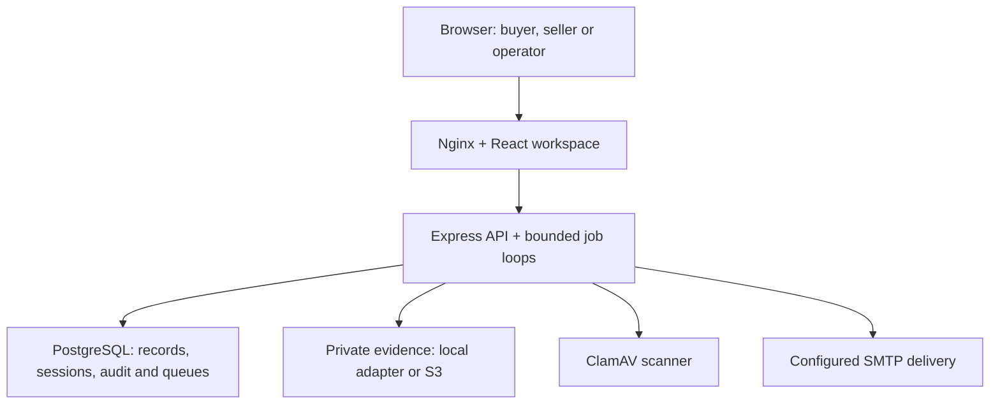

# BetterTrade — current architecture and security

Reviewed 2026-10-17 · INV-004 · Repository implementation, not a hosted assurance certificate.

**Current shape:** a React/TypeScript workspace, an Express/TypeScript modular monolith and PostgreSQL 16. Domain modules cover sourcing, inventory, agreements, recorded payments, fulfilment, evidence and recalls. This is one API deployment with in-process background job loops, not independently deployed domain services. Nginx serves the web build and proxies `/api`; the API can also be reached on its separately published local port. Sources: [app](../../api/src/app.ts), [startup](../../api/src/server.ts), [web proxy](../../web/nginx.conf), [local Compose](../../docker-compose.yml).

| Boundary | Implemented control and qualification |
| --- | --- |
| Browser → API | Cookie-write origin checks, request/query/body budgets and shared PostgreSQL abuse limits. Forwarded headers remain untrusted (`trust proxy=false`); HTTPS and trusted ingress require deployment acceptance. [Middleware](../../api/src/middleware/security.ts), [request limits](../../api/src/middleware/requestLimits.ts). |
| Identity → tenant resources | Signed session credentials reference server-side sessions; requests reload current account, verified organization and permissions. Suspension/revocation removes subsequent access. Route permission checks combine with resource ownership or contract-party policy; no claim of universal negative-case coverage or database RLS. Applicable privileged access requires passkey assurance and fresh verification for writes; sensitive services recheck authority transactionally. [Sessions](../../api/src/services/authSessionService.ts), [auth](../../api/src/middleware/auth.ts), [authorization register](../security/route-authorization.json). |
| API → durable state | Critical business decisions use PostgreSQL transactions, domain lock ordering and atomic audit writes. Payment reminders and recall notifications have durable outboxes; bounded workers use database coordination, retries and terminal-work recovery. This is not an external queue or an exactly-once email guarantee. [Transaction](../../api/src/services/databaseTransaction.ts), [audit](../../api/src/services/auditWriter.ts), [reminders](../../api/src/modules/payments/reminders.ts), [workers](../../api/src/modules/operations/worker.ts). |
| API → file bytes | Authorized, expiring upload intents reserve capacity; bytes enter private quarantine, undergo file-policy checks and scanning, and require current relationship/release checks for use or download. Private local and S3 adapters exist; local Compose uses a mounted private directory and ClamAV. Dependency timeouts fail explicitly; cleanup work is durable. Hosted bucket policy/encryption/access evidence remains outstanding. [Upload](../../api/src/services/evidenceUploadService.ts), [storage](../../api/src/services/evidenceStorage.ts), [scanner](../../api/src/services/evidenceMalwareScanner.ts). |

**Business integrity:** recorded buyer submissions and seller confirmations gate supported dispatch/document flows; buyer delivery acceptance gates completion and custody settlement. Incoterm-specific authority restricts transport actions. Shipment transitions live in [typed workflow modules](../../api/src/modules/transportWorkflow/service.ts), alongside existing delivery use cases. Private evidence downloads and payment creation now have accepted typed policy/repository/adapter owners. Typed recall use-case repositories and current operation-authority policy are accepted. Recorded synthetic tabletop evidence is the next candidate; runtime execution remains pending. Bounded trace/recall traversal preserves holds and refuses to imply clearance when incomplete. Agreement acknowledgements bind a commercial snapshot, exclude separately confirmed payment terms and are not legal signatures. The platform does not hold funds, provide escrow, confirm bank settlement or certify every supplier claim. [Payment policy](../../api/src/services/paymentProtection.ts), [delivery](../../api/src/modules/delivery/workflow.ts), [recall safety](../../api/src/modules/recall/safety.ts), [agreement scope](../../api/src/modules/agreements/policy.ts).

**Release and pilot boundary:** non-root API/web images, production-only API dependencies, integrity-checked migration assets and startup migrations are implemented. The founder reports local release checks and merges through the transport/security boundary wave; that report is not independently archived CI or hosted proof. The [pilot gates](../pilot-gates.json) retain hosted isolation, external email receipt/alerts, managed restore, representative load/SLOs, legal/corridor approval and partner readiness as separate requirements. Local demo credentials/settings are not a production deployment. [Docker runtime](../../api/Dockerfile), [staging acceptance](../runbooks/STAGING_PREPARATION.md).

**Roadmap boundary:** registered/verified logistics-provider discovery, selection and provider fulfilment are future marketplace work. Current buyer/seller transport records and optional provider details do not establish provider onboarding, verification or an integrated service marketplace. Architecture and feature completion do not establish an investment valuation; commercial evidence and pilot outcomes remain necessary. [Delivery backlog](../DELIVERY_BACKLOG.md).
